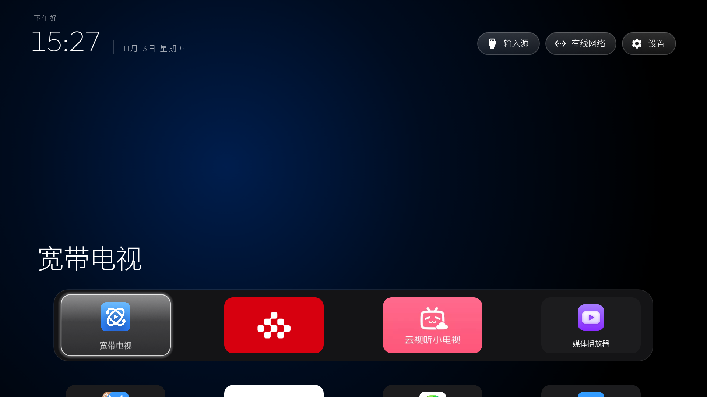

# 创维 70A9（7S86_A9）去广告 / 换桌面 / 开机进直播 —— 完整实录

一台 2020 年的创维 70A9，酷开系统，2GB 内存，卡到遥控器点菜单要等半天。

这个仓库记录了**从零到可用**的全过程：探测、备份、精简、换桌面、以及最关键的——
**为什么这台电视的开机桌面改不了，以及不用 root 的替代方案**。

> 结论先说：**7S86_A9 这个机芯，不改固件就不可能让第三方桌面成为开机桌面。**
> 网上能搜到的"70A9 刷机包"几乎全是别的机芯（7S70 / 7S711 / 8A002 / 9R66），刷了会变砖。
> 但**不刷机、不 root** 也能把 90% 的效果拿到，方法在 [`docs/guard.md`](docs/guard.md)。

---

## 机器信息

| 项 | 值 | 来源 |
|---|---|---|
| 零售型号 | 创维 70A9（70 英寸 4K，2020-09 上市） | 官网 / 电商参数 |
| `ro.product.model` | `7S85_A9` | `getprop` |
| 产品目录 | `full_sky848_7s86_A9` | `ro.build.fingerprint` |
| **机芯** | **7S86** | `ro.build.skymodel` |
| 芯片 | MStar `MST-6A848`（`armv8l` / armeabi-v7a） | `ro.build.skymid` |
| 板号 | `6A658B` | `ro.build.fingerprint` |
| 系统 | 酷开（Coocaa），底层 **Android 8.0.0 / API 26** | `getprop` |
| 固件 | `OPR5.170623.014` / build **`022.008.220`** | `getprop` |
| 内核 | `4.9.44+`（2022-08-22 编译） | `uname -a` |
| 内存 | 1.93 GB（`MemTotal 1938832 kB`） | `/proc/meminfo` |
| 原桌面 | `com.tianci.movieplatform/com.coocaa.homepage.vast.HomePageActivity` | `getprop persist.service.homepage.cls` |

**完整指纹**：

```
Skyworth/full_sky848_7s86_A9/6A658B:8.0.0/022.008.220:user/dev-keys
```

> 注意 `ro.product.model` 报的是 `7S85_A9`，但产品目录和机芯都是 **7S86**。
> 卖家/客服要参数时，报 **机芯 7S86**，别报 `7S85`。

---

## 做到了什么

| 项目 | 效果 |
|---|---|
| 开机广告 | 去掉（包停用 + 守护反复压制） |
| 开机视频 | 15 秒 → 1 秒 |
| 预装精简 | 14 个包停用（不卸载，一条命令可恢复） |
| 原桌面后台空转 | **杀掉**：它不出现在屏幕上，却常驻 279 MB、吃 **115% CPU** |
| 开机落点 | 约 25 秒进第三方桌面 → 再自动进直播 App |
| 第三方 App 安装 | 解除拦截（`pm install -i com.tianci.appstore`） |
| 内存 | 可用 1.05 GB → 1.15 GB |
| 高风险操作 | **零**：不刷机、不 root、不卸载系统应用 |



---

## 为什么开机桌面改不了（核心结论）

酷开把开机行为**硬编码在只读分区的一个 XML 里**：

```
/system/pcfg/7S86_A9/config/general_config.xml
```

里面四个开关决定了一切：

| 开关 | 本机值 | 作用 |
|---|---|---|
| `DEFAULT_HOMEPAGE` | `com.tianci.movieplatform/com.coocaa.homepage.vast.HomePageActivity` | **开机到底进谁** |
| `BOOT_AD` | `true` | 开机广告 |
| `SUPPORT_POWER_OFF_AD` | `true` | 关机广告 |
| `APP_SELF_INSTALL` | `false` | 只允许从应用圈装 App |

`/system` 只读，改它必须 root。而我们试过的**所有**免 root 路线全部失效：

| 路线 | 结果 |
|---|---|
| `pm disable-user com.tianci.movieplatform` | 重启后**被固件重新启用**，且无视停用状态强行拉起 |
| `setprop persist.service.homepage.*` | 重启被写回原桌面 |
| `setprop persist.service.model.pkg/cls` | 重启被 **清空** |
| `cmd package set-home-activity` | 报 `Success`，重启后不认 |
| `com.coocaa.os.multimodel.MODEL_REGISTER`（shim 方案） | `BOOT_COMPLETED` **不投递给第三方**，开机广播从不触发 |
| `stock_home_redirect` + 无障碍服务 | 本机 `dumpsys accessibility` 恒为 `services:{}`，**服务根本不绑定** |
| `settings put global SKY_SYSTEM_ENV_BOOT_START_HOME_PAGE` | 值能持久化，固件**不读它** |
| Dirty COW（CVE-2016-5195）提权改 XML | 内核 4.9.44（2022 编译），**该漏洞早已修复** |

逐条证据与命令见 [`docs/evidence.md`](docs/evidence.md)。

---

## 不 root 怎么办：局域网守护

既然电视自己不听话，就让**同一局域网里的一台常开电脑**代替它执行：

```
每 5 秒：读电视前台窗口
  ├─ 是酷开原桌面 → 改 Home 属性 → 拉起第三方桌面 → 强停原桌面
  ├─ 是第三方桌面 → 确认原桌面没在后台偷跑，发现就再杀
  │                → 若本次开机还没开直播，拉起直播 App（最多重试 3 次）
  └─ 是别的 App   → 什么都不做，绝不打断
```

这是 `stock_home_redirect` 的等价物，只是**执行者从电视内部换成了电脑**。
脚本：[`scripts/watch-home.ps1`](scripts/watch-home.ps1)，说明见 [`docs/guard.md`](docs/guard.md)。

**代价**：电脑得开着。**收益**：零变砖风险、随时能停。

---

## 目录

```
docs/
  01-machine.md        机器参数与探测命令
  evidence.md          改不了开机桌面的完整证据链（8 条路线逐条实测）
  guard.md             局域网守护方案：原理、部署、自启、排错
  launcher.md          桌面怎么编、怎么配（含 dock / app_library / 直播自动启动）
  debloat.md           14 个包的逐个说明与恢复方法
  iptv.md              直播源实测：7 份列表的可用率，以及怎么自己测
  pitfalls.md          踩坑记录（含 3 个别人没踩过的新坑）
scripts/
  watch-home.ps1       局域网守护脚本（Windows PowerShell）
  test-sources.ps1     多源试流：只留下真能播的频道，合成一份清单
  debloat-70A9.txt     停用清单
LICENSE                MIT
```

---

## 快速上手

```powershell
# 1. 电视开 ADB：本机信息页 → 遥控器慢慢按 上上下下左右左右 → 工厂菜单 → 通用设置 → ADB
# 2. 确认端口
Test-NetConnection <tv-ip> -Port 5555

# 3. 备份（先做，别跳过）
#    见 docs/01-machine.md

# 4. 精简
#    见 docs/debloat.md

# 5. 守护
powershell -ExecutionPolicy Bypass -File scripts\watch-home.ps1 -TvHost <tv-ip>
```

---

## 相关项目

- [Gathin23/cleanyourtv](https://github.com/Gathin23/cleanyourtv) —— 本项目的桌面、去预装清单与安全规范都来自它（46K+ star）
- [VincentYe123/coocaa-home-shim](https://github.com/VincentYe123/coocaa-home-shim) —— 酷开专用 Home 跳板（**本机不适用**，原因见证据链）
- [Sisyphus1727/skyworth-55g7200-debloat](https://github.com/Sisyphus1727/skyworth-55g7200-debloat) —— 指明了三个固件开关的位置（该机型用 Dirty COW 改，本机内核已修复）
- [Flynn-kk/skyworth-tv-clean](https://github.com/Flynn-kk/skyworth-tv-clean) —— 酷开 Home 分派机制的分析

本机的实测报告也回帖在 [cleanyourtv#1351](https://github.com/Gathin23/cleanyourtv/issues/1351)。

---

## 免责

- 所有操作都在**自己的电视**上验证过，但**不同机芯 / 不同固件版本差异极大**，照做前请先备份、先小批量验证。
- 仓库里全部是 `pm disable-user`（可恢复）与 ADB 调用，**没有任何刷机、root、卸载系统应用的操作**。
- 刷机相关的警告见 [`docs/evidence.md`](docs/evidence.md#刷机为什么不可行)，请务必看完再决定。

MIT License.
